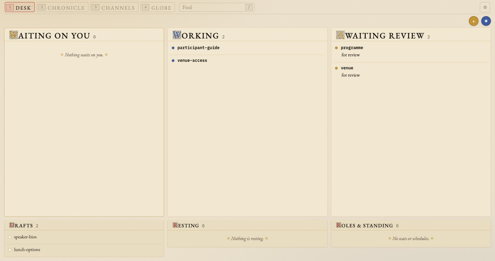
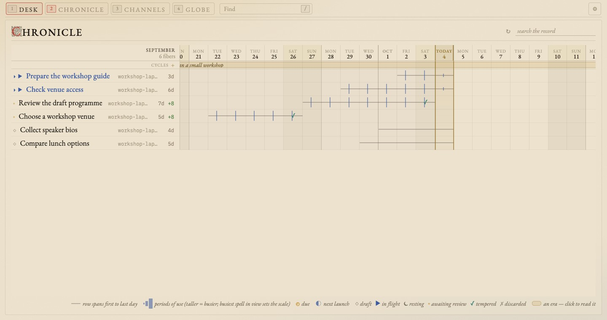

# The board

The daemon serves the board at `http://127.0.0.1:4000/`. It is one page with
four full-page views behind a hotkey row, `1`–`4`, and a settings sheet on
`⌘,`. Everything on it is a view over fibers the daemon already polls, plus
the host-local [ledgers](telemetry.md) — the board stores nothing of its own.

| Key | View | What it answers |
|---|---|---|
| `1` | **Desk** | What waits on you, what is working, and what is quiet |
| `2` | **Chronicle** | What a stretch of weeks was about |
| `3` | **Channels** | Where the work talks to you: a channel per line of work, a thread per worker |
| `4` | **Globe** | Everything at once, as one place to move through |
| `⌘,` | **Settings** | Every operator file, on any host in the fleet |

`#/desk`, `#/chronicle`, `#/channels` and `#/globe` deep-link the views; `#/board` opens Channels.
A constitution uses `#/board/<uid>@<owner>/<document>`; browser Back returns to the view you opened it from.

## Desk — three states

The Desk has three columns: **Waiting on you**, **Working** and **Quiet**.
Each holds family cards: a top-level constitution with everything under it, its threads at any depth.
Every family appears once, in the column of its most urgent member, waiting before working before quiet.
A family whose top-level has a verdict (tempered or discarded) stays off the Desk unless something in it still waits or works.



*The cards use fictional data.*

### One state

One function, `attentionOf` (`ui/src/board/attention.ts`), decides a constitution's state, and every surface draws only that: the Desk's columns, the state dots, the Channels rail and stream, and a constitution's view.

| State | When |
|---|---|
| **Waiting on you** | The board says a line to you stands unhandled: a post (`shuttle post --to` you), a question or a close addressed to you, until you answer that fiber, it is handled, or you clear the post. Or it has an open `shuttle ask`, its worker is stopped on a harness prompt, its turn could not start (a launch error, a session that could not be identified), or it is closed for your review (a thread its orchestrator marked for you, or whose orchestrator is not on the board, included). |
| **Working** | It has a live worker, whatever the worker's turn: mid-turn, starting, without a signal, or idle at its prompt with nothing asked. |
| **Quiet** | Everything else: drafts, rest, seats, launches held at boot, closes its orchestrator reviews, verdicts. |

A verdict settles everything: a tempered or discarded constitution is quiet.
The dot says the state: gold while it waits on you, the agent's blue while it works (breathing while its worker is mid-turn, still while idle), hollow when quiet. Its tooltip says what it wants, else its worker's turn.

The owning daemon still serves each constitution's lifecycle column (`column`, by the rule `shuttle status --json` reports, `internal/shuttle/column.go`) and its worker's `turn` (`Shuttle.Lifecycle`); the board reads them to decide the state, and draws neither as a word.

### A family card

A card names its top-level by its slug, with its dot. Under it, every member that waits on you has a line, `slug — what it wants`, none capped or folded: the question, the review mark's note or *for review*, the post, or why the turn could not start (the top-level's own want stands without its slug). A waiting post carries a ✓ that clears it, as in Channels.
A working family with threads says how many of its members work (`3 working`); a quiet card says its faint word: *draft*, *resting*, *resting until* a day, *paused*, `↻` and its next run, *seat* or *held*.
A line opens that member's view; anywhere else on the card opens the top-level's.
Waiting on you is ordered newest wait first; Working and Quiet by latest activity.
On a phone the columns are three leaves of a pager under a folio of three tabs.

The Desk's head row carries `+`, which stashes a new draft, and `✶`, which captures an idea by voice.
Nothing on the Desk is dragged and it has no context menu: every act on a constitution lives in [its view](#a-constitutions-view).

<a id="attach"></a>
### Open a worker

The conversation icon (›_) in a constitution's view head opens the conversation of its fiber, and `c` does the same while the view is open; the console's own icon opens its target's when that is a different constitution.
Tap to open; long-press or right-click the icon to choose a destination.
A choice between alternatives is remembered; opening a sole destination leaves the preference unchanged.
For terminal workers, the board can open Kitty; `shuttle attach <fiber>` works from other terminals too.
Claude sessions with Remote Control can open in the browser or Claude app, using your browser's preference in Settings.
Codex workers open in their terminal session; remote access depends on the host terminal backend.
See [Opening conversations](conversations.md) for the choices, prerequisites, and quick-access terminal setup.

### Desk keyboard

Bare keys act on the Desk when focus is outside an editable field.
`j` / `↓` and `k` / `↑` select the next or previous card or waiting line, across the columns, stopping at the ends.
`g` and `G` select the first or last in the current column.
`l` / `→` or `Enter` / `o` opens the selected constitution, `h` / `←` or `Esc` clears selection, `/` opens Find, and `?` shows keyboard help.
The Desk's keys only move and open; they act on nothing.

## Chronicle — where the time went

The activity stream bucketed per minute, joined to fibers through the session
and commit ledgers. See [Telemetry](telemetry.md) for what feeds it and what
happens when a ledger is absent.

Chronicle draws fibers as multi-day lifelines across calendar days, under a
strip of [cycle](cycles.md) bands. Activity is inked on each lifeline, one mark
per civil day; ahead of today a row carries only hollow marks for what is due
and what is armed.



*No fill, just marks on a line per fiber, so months of fibers stack without
drowning each other. The era strip is the [cycle](cycles.md) data.*

Everything on the page is joined through the ledgers. A minute or a commit
that does not resolve to a fiber the board carries is not drawn at all, so work
started outside shuttle is invisible here — and nothing is ever attributed by
reading a `slug:` prefix out of a commit subject or a directory name.

**The record is fetched on demand.** The Desk's cards refresh every 15 s, and
Chronicle redraws its rows from them, but its temporal feeds — activity, the
session ledger, the commit ledger — are fetched when the view opens, again at
most every five minutes while it stays open, and whenever you ask with the
refresh control. Days already past are fetched once per open; scrolling back
fetches only the days newly in view. Nothing on the board asks for temporal
data while Chronicle is closed.

## Channels — where the work talks to you

Hotkey `3` opens Channels, which reads like Slack. A constitution speaks in its own `shuttle.channel`, else in its orchestrator's, else in that of the nearest constitution filed above it; without one anywhere above it, the channel is its top-level constitution's office (merged into the named channel that shares its charter's name), or that top-level alone, named by its slug and drawn quieter in the rail.
A channel's chair is its topmost seat, a non-standing one first, then the most recently active; without a seat, its most recently active top-level. The channel's head carries the chair's pages (its constitution, its tapestry, its sent files) beside the channel's name, and the [console](#the-reader) at the foot of the channel speaks to the chair.

**Six rules are the whole contract.**

1. A channel shows what its workers addressed to you, one item per worker. Posts to the family and messages between workers stay out.
2. A dot means one of two things: gold, waiting on you (a post, a question or work for review addressed to you, or a worker that cannot go on without you); ink, new to you since you last read the channel here.
3. Choosing an item opens that constitution's [view](#a-constitutions-view). The console says whom you are talking to.
4. Rex and voice follow your clicks and nothing else: an item, a page, a thread's row. Opening, paging or returning to a channel moves nothing, and nothing moves on a timer, when you come back to the window, when voice comes on from anywhere but the board, when the board loads or reloads, or when a session asks the board to show a page.
5. Each thing shows once on the screen; a page or a figure is a thumbnail that opens it.
6. The board remembers where you were and nothing else per device: what the rail lists, the pins and the order are the same on every device.

A channel's stream, oldest first, holds each worker's one item: what waits on you if anything does, else the latest thing it addressed to you. That is a post (`shuttle post --to` you), a question, or a close addressed to you (a top-level close for review with its closing post, or a thread its orchestrator marked for your review with its note), each with the files it attached; or the files it sent you on their own (`shuttle send-file`, SendUserFile), sent within ten minutes of each other, with their captions. A close shows its review note and its tapestry as a thumbnail; its closing post is its outcome, which the board does not draw. A post, a question or a close waits on you until you answer that fiber, it is handled, or it says something newer, as the daemon keeps it; an open question, a worker stopped on a harness prompt, a turn that could not start, or a close for your review waits too, whomever its line was addressed to. A waiting post carries a ✓ that clears it: it writes the clear and nothing else (`clear:<uid>:<the post's time>` through `POST /api/v1/channels/dismiss`), so the post stops waiting and a later one waits again. A question is handled by answering it, a close by its verdict in the constitution's view. A worker idle at its prompt with nothing asked waits on no one. A channel waits when any of its constitutions waits, by the one rule every surface uses. A thread's posts, questions and closes to its orchestrator are not addressed to you, and neither are the files they attach. Each path is drawn at its newest send. A page or a figure is a small thumbnail alone, side by side with the item's other files; any other file is a chip named by its file name. An item names its worker by its slug, says what kind of thing it is and when, and gives its words on two lines at most. Between the items, small muted marks say a thread started, was handed off, or closed to anyone but you, so you see at a glance whether the channel's workers are working or have all stopped; they never count as new.

The rail lists the channels waiting on you, pinned, or active in the last week, and the one you are reading. What waits on you floats to the top, the newest wait first; everything else follows in your order. A channel with something new to you since you last read it on this device carries the ink dot; one you have never opened here counts what it holds as new.
Drag a channel to move it (on a phone, hold it still, then drag), or focus it and press Alt+↑ or Alt+↓.
Right-click a channel, hold it and lift, press the context-menu key or Shift+F10 on it, or use the menu icon in its header for its menu: **Hide** takes it out of the rail until something new waits in it, **Pin** keeps it in the rail and **Unpin** lets it go, and **Move to bottom**.
The order, pins and hides are kept by the daemon (`shuttle channels order` and `dismiss`), so every screen agrees.
**Jump to** at its top (`/`, or the bar's Find) finds any channel by its name or its members' names and paths, hidden ones too, marked so, and lists every sent document it matches, from any fiber; opening a channel found brings it back to the rail.
`[`, the rail icon, or a sideways swipe hides and shows the rail; on a phone the rail is the first screen and a channel fills it; a swipe or the back arrow returns to the rail, leaving the channel, and a leftward swipe goes back to it. Where the view is narrower than about 1100 pixels, a half-screen window for one, the rail is a drawer drawn in over the stream, ending above the console.
The page carries no key hints: `?` lists Channels' keys with the rest.
Documents of a fiber the board does not hold are read from their owner; a fiber its owner confirms missing files its documents under **Unfiled** on their byte-owning host, and an unreachable owner does not count as a missing fiber.

### The reader

Opening a file, a line or a constitution enters the reader: one selected page, its neighbours waiting hidden, and no column beside it.
The reader is one frame: beneath the board's bar, the selected page fills the window, with its header line on top and the document below it. The header line holds back, the page's name, its arrival, the sent files toggle, Expand, a file's download and the document menu.
The download (an arrow onto a tray) saves the file under its own name, its bytes read through the owner-routed file route, so a file on another host downloads the same way; on the phone it lives in the document menu as Download.
The sent files toggle appears at every width when the constitution has sent files, on the phone in the top bar, and its first bullet swells while one is unread; it opens the sheet of sent files, as the document menu's Sent files does.
In the reader, as on the Desk and Chronicle, the board bar's Find hangs a list of constitutions beneath itself, matching names, paths, filenames and transcripts. On the phone the title opens a switcher of constitutions instead.
The fiber page anchors its body, embedded files, opened body links and sent documents.
A constitution with a project directory has a **Change** page right of its fiber page: each time it opens, the owner bakes the project's [change](../concepts/changes.md#the-change-on-open) as it stands, showing Baking… meanwhile, or the reason a bake failed. A constitution that follows two or more PRs (`shuttle.change.prs`) opens its Change page on their list instead: number and title, head → base, state, checks and line counts, read from GitHub without a bake. A row opens its PR in the page under a bar with the way back to the list and steps to the PRs either side, and the page reopens on the PR left open.
Repeated sends of the same owner/path are one page with multiple receipts.
Selection, constitution changes, and metadata polls preserve retained document instances and reading position.
The board renders no conversation. Conversation lives in Rex, on the desktop and on the phone; the board keeps a constitution's threads, its tapestry and documents, its sent files, its change reader and its lifecycle.

**What the board looks at, voice and Rex follow together, and only on a click.** Opening a Desk or Chronicle card, any page in the reader (a constitution's view, a tapestry, a document), a thread's row or an orchestrator's head in a view, a thread on the Globe, or an item, a file or one of the chair's pages in Channels makes the board look at that fiber's constitution: voice targets it and, on the desktop, Rex moves quietly to its live worker's window, behind the board. A click never opens Rex. A thread with no live worker, a stopped one or one with only a past session, leaves Rex as it is: a click starts no program, creates no session and resumes nothing, so clicking around leaves no trail of terminals. Every surface calls one function for this, `Workspace.look`, which posts `select_only` to `POST /api/v1/attach` and rings the thread only once the daemon says Rex moved; looking again at the same worker, or at the worker Rex just moved to itself, posts nothing, looks in quick succession move Rex once, to the last of them, and Rex is left alone while the board lacks the keyboard. Stepping to the next or previous constitution with `j`, `k`, `J`, `K` or Alt-↑/↓ is a scan, not a look: like pulling a view down to its orchestrator's, it moves neither voice nor Rex. Opening is an explicit act: `c` (or `.`) opens or creates the conversation's window, reopens a past session, and brings Rex forward. Rex keeps its view to what is in focus, plus the workers asking you something and those running a turn: a window you moved away from leaves it after two minutes while its worker runs on, and a click or `c` brings it back. Workers on other hosts follow the same rule. On a phone a click moves nothing.
Nothing that is not a click looks: a poll, a page's data arriving, a worker starting, the board's window coming back to the front, the board loading or reloading on a page, or a session asking the board to show a page leaves Rex and voice where they are.
Every constitution, a draft included, and every fiber with threads opens on [its view](#a-constitutions-view), whatever level it sits at.
One console, the board's one chat bar, is docked at the bottom of the reader under every page of a fiber on the Desk's lifecycle, and at the bottom of a channel; what is above it scrolls, and on a phone it stays above the on-screen keyboard. Its head is one row of slugs and controls: the channel's handle and the slug of whom it speaks to (`felt / outbox-for-the-human`; the slug alone when it is its own channel), its full name in the tooltip, then the session's figures. Where the head has room its acts stand as buttons: **Open conversation** first, Settings, whose sheet opens above the console, and the constitution's page, which a channel's console leaves to the channel's head; where it is short a menu (⋯) holds them all. It gives no verdict: those live in the constitution's view. A verdict's undo stands in its acts' place. The console draws no back and no ×. No word says the constitution's state: its colour does. Beside the name it shows the session's context size, tinted from verdigris toward red as it fills the window, and Claude's estimated prompt cache as a dot that drains as the entry ages and turns into a red ring once cold; hover either for the numbers. Resume's tooltip says until when the cache is warm, and Settings adds the share of recent context read from the cache. These facts come from the session's transcript on its host, so they hold with no worker running. On a phone the reader's top bar goes back, so the console draws no back of its own.
Under the head, the worker's line acts on the page's constitution, which its placeholder names by its slug (`Message outbox-for-the-human`): a one-line message field, then Send (Resume while the field is empty and the worker has a past session, Start when it has none) and New session. Enter takes the first verb; in Channels an empty Enter does nothing, so a stray key starts no worker. A line sent is placed by the owning daemon, not by the board's copy of the card: typed into a live worker, otherwise the opening message of a fresh session after a clean handoff, or of the resumed session when it ended without one (`resume_mode: continue`). Start lets the daemon choose the same way, so a worker the board does not show yet is found rather than cut; Resume and New session say which session they mean. The board gives each line a message id, kept when a failed send is tried again, whatever the card shows by then, and the owner records it in the fiber's inbox before transport. A retry under that id submits nothing unless the first try was definitely refused, and an ambiguous paste is not automatically retried: when the first try was not confirmed delivered, the line says it may not have arrived and keeps the words, and sending again sends them as a new message; an empty line resumes or starts with nothing said, and Send waits for words. New session over a live worker asks before cutting it. After a send the line says Sent, Resumed or Started, and shows no transcript; outside Channels, a start opens the worker on the desktop.
Listen is one mic toggle: off, it starts unmuted; on, it mutes and unmutes, with a slash when muted.
Listen has four routes: off, following you, pinned to a card, and a meeting on a card, which is pinned there and transcribes the computer's audio as well as the mic.
The ▾ menu names the current route and offers only the moves from it: off, **Start meeting on this card**; following, **Pin to this card** and **Start meeting on this card**; pinned, **Follow me**, **Pin to this card** when pinned elsewhere, and **Start meeting on this card**; in a meeting, **End meeting**, which follows again.
Below them sit **Quiet seconds** for following or pinned listening, **Today's transcript**, and **Stop listening** while on, which also ends a meeting.
A meeting ends itself after twenty minutes with nothing heard; agents start and end one with `shuttle meeting start` and `shuttle meeting end`. Echo cancellation keeps playback out of the mic either way.
The destination slug sits beside the mic, prefixed with 📌 when pinned, ⏺ in a meeting, and empty when off; failures turn the mic red, with the reason in ▾.
On a phone, Listen uses the phone mic, with the same mute and routing controls but no meeting; keep the browser in front and the screen awake.
Today's transcript opens a day reader with times, speakers and destination slugs, optionally filtered to this card.
The fiber header shows status alone. Agent, effort, cadence, host and project directory belong to the folded settings line; the console's worker line is only its conversation action.
Document header lines show the title and arrival history, omit the agent, and name a host only for a document owned elsewhere. The fiber label shows its genuine last-change time.
A file open on any page is watched while you read it: when its worker rewrites it, the new copy loads out of sight and takes the old one's place at the same scroll offset, or at its new end if it got shorter.
Media, PDF and unsupported viewers add no title or provenance block inside the page. Audio/video use native transport controls; retained media pauses when receded or parked.
The ‹ button, browser Back and the phone's right swipe follow the pages you visited, across constitutions and linked files.
The back control names the constitution across channels, or the page within the same channel: Constitution or the file's name.
A direct address without a visited page behind it returns to its origin view (Desk, Chronicle, Channels or Globe).
Reloads retain this path in browser history.
Ancestry links, an orchestrator's head in a view, and `b` go up the thread tree.
Opening a different page adds a history stop, including a link to a page just visited.
Reselecting the same page leaves history untouched.
Stepping between constitutions with j/k or J/K replaces the current visit.
One Back or root Escape returns from a step to its predecessor; returning to Desk selects the last card viewed.

Bare reader keys work outside editable fields: h/l or left/right step pages, and in a constitution's view, away from the rows, `l` opens its tapestry or report, else its newest sent file; j/k step constitutions in the Desk's order as one flow, each family's top-level then its members that wait, across its columns (Waiting on you, Working, Quiet), and J/K jump between those columns, landing on the constitution last open in each; a brief toast names the column and constitution a step lands on, and a constitution outside the Desk stands after its nearest ancestor there; down/up scroll about three lines, repeating while held; d/u scroll half a viewport; Space/Shift-Space scroll a full viewport.
g/G or Home/End select first/last pages, Enter/o toggle expand, and Escape unwinds popovers, expand, then returns.
The constitution keys act on the open fiber in the reader, its lifecycle keys only while its view is the page shown: c (or .) opens the worker's conversation exactly as its pill does, and with no worker up reopens its past session in a terminal on its host, in any column: nothing is sent, no turn starts, and the card's lifecycle does not move (a card that never ran is launched from the console); t tempers, x discards and a moves work in progress, or a thread with its orchestrator, to Awaiting review (a thread so moved is marked for your review), each after the same undo window (z takes the latest back).
s in a constitution's view opens a small date popover: Enter with no date rests undated, and a chosen date rests until that day.
Rest works in any state and stops a live worker through the owning daemon's lifecycle path. A rest or a schedule paused on the board names `board` as its actor in the ledger.
Alt-left/right step pages and Alt-down/up step constitutions, including while typing.
A plain fiber reached by wikilink keeps the tab label **Note**.
The tablist keeps one Tab stop and moves focus with its selected tab.
HTML documents get first refusal on their own keys; native PDF and media viewers keep their controls.
`?` shows the shared keyboard help.

### A constitution's view

Every constitution, reached from a Desk row, a channel, a role or a thread, opens one view, the same wherever it was opened from. It answers whether the work needs you and where it stands, and leads to everything else; what a constitution came to is read in its pages, not here.

- **Up.** Its orchestrators read above it as a path, the family's top-level first (`hub / pipeline-steward /`): each a state dot and its slug. Choosing one opens its view; so does pulling the page down past its top (a scroll's momentum carried up to the top does not count), which, being no click, moves neither Rex nor voice.
- **Head.** Its state dot and slug (its full name in the tooltip); what it wants of you, in the owed gold (**asks**, **for review**, **posted**, **blocked**), or, when it is quiet, its faint word (draft, resting until a day, paused, ↻ its next run, seat, held); its run, `working since 14:02` while its worker is live, else `worked 2h 14m · stopped 40m ago`, or `not run`. Then its pages as icons, the same row a channel's head carries for its chair: its constitution, its tapestry or report, its sent files with their count (the newest opens, and the reader steps through the rest), and, for a fiber with a project, its edits. Then its acts: its conversation, its settings, and the verb that fits its state with the rest behind its caret, each named with its key (Close for review `a`, Rest `s`, Temper `t`, Discard `x`; a standing constitution's Pause or Resume schedule, Temper run and Retire), and, for a launch its daemon holds at boot, **Release boot quarantine**, which frees that daemon's held launches. This head is the one place a constitution takes a verdict or a rest.
- **Words.** Under the head, the last thing it posted, a line or two: its newest post, question or close note the family board holds (never a closing post, which is its outcome), its open question, or its review note, with its age; nothing, and no space, when it has said nothing.
- **Threads.** Its own threads as a narrow column of rows, what waits on you first, then what is working, then the quiet, each most recently active first: a state dot, its slug, its run, then what it wants in one line when it waits on you, or its faint word when quiet, and a chevron. Beneath a thread hangs every thread below it, at any depth, that waits on you (`↳` and its slug, with what it wants), and such a thread stands with what waits. Choosing a row opens that thread's view.
- **Preview.** Beside the threads, taking the rest of the width, a large live preview of its tapestry, else of its newest sent file, which opens it; a file shown here counts as seen. On a phone it stands above the threads.

The console at its foot speaks to the constitution the view shows; so do the lifecycle keys and `c`. Over the view, the console draws none of the pages and acts the head already carries. The way back names a fiber by its slug. With the keys on its rows, `j` and `k` (or down and up) move among the orchestrators and the threads, Enter or `l` opens the one in focus, and `h` opens the orchestrator's view, or from the top of the family goes back where the view was opened from; moving the focus moves nothing else.

When Rex's worker changes, from its sidebar or otherwise, the board goes to that fiber's view, with voice on or off, without speaking back to Rex; a page of the same fiber stands, so opening a file does not bounce back. Rex merely coming to the front moves nothing on the board. The Globe shows such a fiber in place.

The view reads its feeds and repaints only while it is the selected page of an open reader, and runs nothing in between.

### Where voice goes

With Follow me on, whichever of Rex and the board moved last chooses the destination: Rex's selected worker, or the card last clicked on the board and its nearest constitution.
Opening a page, a thread or a Globe card moves the destination; hovering, moving a keyboard highlight, opening a channel or returning to the board's window does not.
With Follow me off, the destination stays pinned while views continue to be remembered; turning it back on resumes the latest view seen while listening.
Following sends after a short quiet, but words for a card without a live worker go nowhere unless they end with a standalone “send” clause (for example, “check the plot, send”; “sent” is taken as the same word), which starts the worker; pinned listening sends every batch and starts a worker when needed, using its own longer quiet threshold.
The recorder's day transcript retains all speech, including unrouted or undelivered words, and every delivered batch points to its time in `shuttle transcript`.

The receipt feed is `/api/v1/sent-files/all/composite`, which combines each host's event stream.
The board reads its last thirty days at most once a minute, into one store the Desk's report marks, Channels and the constitution views share; an unchanged feed answers 304.
A host without an event stream contributes no receipts — see [Telemetry](telemetry.md).

## Globe — everything on one sphere

The Globe holds the whole fleet on a HEALPix sphere: zoom out and it holds everything running, zoom in and you reach a project, a family, a thread, its files and its finished work. `ui/src/board/globe/` is the view; its boundary maths is checked against healpy.

**Latitude is state.** The twelve base pixels are three bands of four. The north holds families with anything in flight, the equator families at rest, the south families wholly finished, so a family's latitude says where it stands and going south is going into the past. Within a band each project is one cell, its province, labelled with the project's name. An area the ids name, such as `ai-futures/felt/`, is a cell inside that when two or more families share it, and families lie inside those. A project appears once in each band it has work in.

**Area is a share of the work.** The nested scheme is a quadtree, so each size is a power of four, and siblings are packed by a buddy allocator. A cell is as large as it must be to hold what it holds, heavier threads take more, and shares are compressed so that a hub of a hundred threads does not reduce a lone thread to a speck. Not every tile is filled: the rest is ocean, or the ground of its parent.

**What is live gets the area.** No family is larger than a cell of order 2, so ocean stays between families, and within a family live threads fill it. A thread with threads gives them its north, west and east quadrants, sized to fill them, heavier and fuller threads first. Its south quadrant holds the rest: its tapestry or report at the centre of the cell, its constitution and files to the east of that, its settled threads below. When none of its threads is live, the settled ones take the three quadrants. A thread with no threads keeps its north quadrant for its name, its tapestry to the west and its files to the south and east, a lone file largest, with its constitution at the east's corner. A tapestry's place is kept before it is read, so its arrival moves nothing.

**Places hold.** Each sibling follows a path of quadrants drawn from a hash of its persistent id, and the eldest choose first, each taking the first free cell of its size along its path. A new thread takes what is left and usually moves nobody; every third or so makes a sibling give up a spare cell, which shifts some of that family's threads. A thread that changes state moves almost alone, within its family, and other families stay put. A family that changes band moves whole. A band that crosses a size limit rescales in place.

The tile's colour is its state, in the Desk's pigments, and it fades with age. Archived threads keep a third of their colour and go unnamed, so a hub's finished work sits quietly in its south quadrant; they wake when the view comes to them or to the archived thread they lie in, and a tile of one is named once it is wide. A tile too small to open shows the most urgent thing inside it.

**Pages show what they hold.** A tapestry, report, constitution or sent file is a page tile, in paper grey rather than a state's colour. From about 26 pixels it carries the mark of its kind (▨ an image, ▣ a page, ▧ a PDF, § a constitution) in its north quarter, clear of its name. From 130 pixels a file or tapestry shows its thumbnail instead: the plot itself, or a page's first screen, the board's own thumbnails in the largest box of the file's shape that fits the tile, named beneath when there is room. Thumbnails load as their tiles come into reach, nearest the centre first, within the board's one loading budget; none starts during a flight, and they stay cached a while after they leave the screen. A file its host no longer has shows its name and kind. What asks keeps a marker of constant size from any distance, and what asks over the horizon waits at the rim at its bearing. The chips under the trail count what asks, and clicking one walks to the next of that kind. The peek at the foot names the tile under the pointer or in focus, with its order and nested index.

**Moving.** One hand does it: scroll zooms about the pointer, and so does a pinch, down to the smallest thing there filling the stage; drag turns. The globe turns freely, over the poles and on: the point you grab stays exactly under the pointer at any zoom and orientation, a drag beside the sphere turns it by its rim, and a let-go drag coasts to a stop. North rights itself only while the hand moves, turned about the grabbed point, so it never slides out from under you, and every flight lands north up. The view opens looking straight down on the north, where everything in flight is. A flight frames a tile whole between the trail and the peek. Under the tile in focus names come first, live threads before archived ones. A name that its tile cannot hold stands nearby inside the focus, or out on the open water beside it, never across its edge, with a fine line back to its tile. Names grow in as their tiles can hold them whole, and the grid, drawn under the tiles, refines with the zoom.

**Mollweide and the plane.** `m` or the switch at the top right steps from the globe to Mollweide's whole sky, the map healpy draws, and on to HEALPix's own plane (Calabretta & Roukema 2007), looking where the last one looked. The plane lays the twelve base pixels out as diamonds in three rows, north in flight on top, every cell a straight square diamond, the polar ones included, scaled to the sphere's area so a tile is as wide on it as on the sphere; it wraps east and west and keeps itself in view top to bottom. On the globe the cells near the poles are sheared as HEALPix makes them, and Mollweide squeezes the polar row where everything in flight sits; the plane shows them undistorted. Clicks, zoom and flights are the same on all three.

**Clicking.** A click on a thread flies to it and moves Rex to its window at once, if it has one; on a phone a tap comes to it. A click on a tapestry, report, file or constitution opens it on the stage, and Back returns to the Globe as it stood. A click on a province or area flies to it. Zooming, turning and stepping back never touch Rex. A click in Rex flies the Globe to that thread, as it moves the family map, while voice is on.

| Key | On the Globe |
|---|---|
| `Esc`, `h` | One level out |
| `←` `→` `↑` `↓` | The previous or next thing that asks, most urgent first |
| `Enter` | What a click does, on the tile in focus |
| `/` | Find; picking a thread flies the Globe to it, leaving Rex and the stage be, and a fiber the Globe has no tile for opens its page |
| `+`, `-` | Zoom |
| `m` | Globe, Mollweide, the HEALPix plane, in turn |

## The board is optional, and the bundle is its own artifact

A fetched daemon already has it: CI builds the bundle and copies it into the
release's own `priv/`, so a downloaded daemon serves the board with no Node
anywhere in sight.

A checkout serves `ui/dist` from the checkout, and the repo does not ship that.
Build it with:

```bash
make ui        # npm ci when the lockfile changed, then npm run build
```

A fresh clone builds it fine — no private checkout needed (see [Sharp
edges](troubleshooting.md)). `make build`, `make restart` and `make
all` all include this step; `SKIP_UI=1` leaves the bundle alone, which is how a
host that takes its bundle from elsewhere is built.

`SHUTTLE_UI_DIST` overrides both, pointing the daemon at any built bundle on
disk.

Without the bundle the root URL 404s with a hint, and the API stays fully
usable. If you change any `/api/v1/*` route, rebuild the bundle — a stale
bundle against a changed route table fails silently as a 404.

## Settings

`⌘,` opens the settings sheet, and so does a bare `,`: the board's own idiom
is bare keys, and a phone has no `⌘`. The ⚙︎ closing the tab strip does the
same with a pointer, pinned to the right edge on a phone so it never scrolls
out of reach. `Esc` closes it. It is an overlay rather than a fourth tab — the
three tabs are windows onto the work, and configuration is not work.

Settings opens to **Conversations**, where you choose the preferred destination for the console, keyboard opening and History.
The conversation-opening preference belongs to this browser and saves immediately.
Long-press or right-click the console to choose another supported destination.
Choosing among alternatives remembers the destination; opening a sole destination leaves your preference unchanged.
When the preference is unavailable for a worker or device, opening uses the best available destination without changing it.

Host settings sit separately under **Worker hosts**.
The host picker selects which machine the remaining configuration addresses. The board is reachable from a phone and from a second hub, so the
machine you are configuring is usually not the one you are sitting at; every
read and write on the sheet carries the chosen host's origin and is
owner-routed to the daemon that owns the file. Configuring a remote needs that
remote's daemon to be recent enough to serve the config routes; an older one
says so.

| Section | What it holds |
|---|---|
| **Conversations** | The preferred conversation destination in this browser; worker execution stays unchanged |
| **Notes & tasks** | `stores.json` — the store list this daemon is configured with, and the symlinked substores it reaches through them |
| **Project folders** | `projects.json` — the checkouts Stash and Capture offer; adding one initializes its `.felt/` |
| **Worker agents** | The merged registry, each record marked with the layer it came from, with a default-effort select per agent (written as an `overrides` entry), over `agents.json` |
| **Connected hosts** | `remotes.json` as rows — how each remote is reached, whether it answered, what build it is running — plus the supervised tunnel jobs derived from it |
| **Access & listening** | Whether this is a personal or shared machine, and who can reach its daemon |
| **Daemon status** | Build, CLI contract, poll health, running workers, and the boot quarantine |

**Host configuration sections offer an advanced text editor for their files.** That is what makes
the sheet hold *all* the configuration rather than all of it there is a widget
for, and it is the only safe way to touch `remotes.json`: a structured round
trip drops every key the model does not know about, and that file carries
several (`auth`, `ssh_flags`, `tunnel.label`, per-entry timeouts) that
`shuttle remotes add` has no flag for. A save is refused unless the tool
that really reads the file accepts it first, and the refusal is that tool's own
sentence — see [the API reference](../reference/api.md#the-operator-files).

Two things the sheet will not do. It will not edit `~/.shuttle/host`: the
daemon freezes its host id at boot, so a file rewritten under a live daemon
would leave the CLI and the dispatcher disagreeing about what this machine is
called, and that is the worst failure this system has. And when `SHUTTLE_STORES`
or `SHUTTLE_PROJECTS` is set in a daemon's environment — which overrides the
file's contents outright — the section says so and turns editing off, rather
than letting you carefully fix a setting that has no effect.

A card that never appears at all is usually a dispatch question rather than a
board question — see [Diagnosing a missing card](lifecycle.md#diagnosing-a-missing-card).
