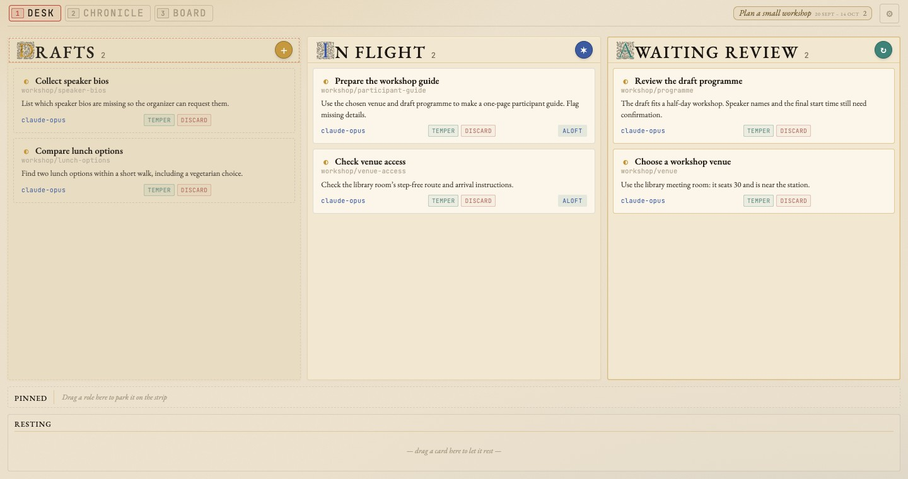
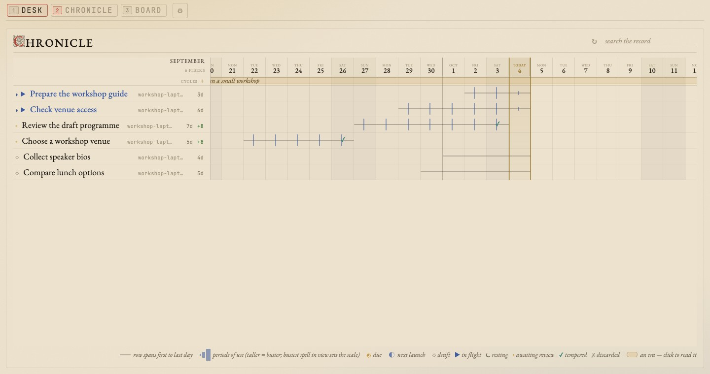

# The board

The daemon serves the board at `http://127.0.0.1:4000/`. It is one page with
five full-page views behind a hotkey row, `1`–`5`, and a settings sheet on
`⌘,`. Everything on it is a view over fibers the daemon already polls, plus
the host-local [ledgers](telemetry.md) — the board stores nothing of its own.

| Key | View | What it answers |
|---|---|---|
| `1` | **Desk** | What needs doing, and what is running right now |
| `2` | **Chronicle** | What a stretch of weeks was about |
| `3` | **Board** | What the work produced |
| `4` | **Tree** | Where everything is |
| `5` | **Globe** | Everything at once, as one place to move through |
| `⌘,` | **Settings** | Every operator file, on any host in the fleet |

`#/desk`, `#/chronicle`, `#/board`, `#/tree` and `#/globe` deep-link the views.
A constitution uses `#/board/<uid>@<owner>/<document>`; browser Back returns to the view you opened it from.

## Desk — the kanban

Three surfaces: the **Now** board of cards that need something; **Roles**, a
band of launcher chips for every seat at rest (a constitution with
`shuttle.seat: true` and a role), in name order and never paged; and **Resting**, where
everything else put down waits — paused and snoozed work, the hubs you start by
hand, and standing constitutions between runs.



*The cards use fictional workshop data.
Each card shows its fiber's `outcome`, so the venue decision is readable beside the guide that uses it.*

Where a card lands is two independent decisions: which column it belongs to,
and which horizon it sits on.

### Column

The browser computes column membership with `classifyFiber`
(`ui/src/board/KanbanRules.ts`). That function decides membership alone, and it
evaluates in this order:

| Column | Condition |
|---|---|
| Cycles | tagged `cycle` — checked first, unconditionally |
| Tempered | `closed` + `tempered: true` |
| Discarded | `closed` + `tempered: false` |
| Awaiting review | `closed`, `tempered` absent |
| In flight | live tmux worker with a shuttle block — liveness wins over everything below |
| Roles | `shuttle.seat: true` with a role, and at rest: not `active`, or `active` + `kind: standing` between runs |
| Scheduled | `active` + `kind: standing` — drawn in Resting, wearing its next launch |
| In flight | `active` oneshot |
| Drafts | anything left, including `open` |

In flight draws two bands, decided by whose move it is. **Your turn** holds
live workers whose move is yours: questions first and drawn heavier (an
outstanding `shuttle ask`, a harness prompt, or a blocked launch), then workers
idle at their prompt with nothing they started still running. **Working** holds
the rest, including a worker idle over its own background shells or
subagents. The daemon reads those live children from each harness: Claude
Code's `background_tasks` on `stop`, Codex's `spawn_agent` calls and
`subagent_stop` events, and Codex terminal sessions that name
the worker as `parentThreadId`. A harness that reports none reads as your
turn when idle. Cards keep creation order within each tier, so a card moves
only when it crosses the seam or a question is raised or answered.

One derivation, the card's *turn*, decides the band, the order, and the
worker pill on every surface, so a card can never sit in Your turn with a pill
that says otherwise. The pill's word names why it is (or isn't) your move:

| Pill | Band | Meaning | Age counts from |
|---|---|---|---|
| **question** | Your turn | The worker needs an answer: an outstanding `shuttle ask` (the worker may still be working, and its dot breathes), or the harness stopped on a prompt. | the ask, or the prompt's event |
| **idle** | Your turn | The worker ended its turn with nothing running under it. | the last event |
| **blocked** | Your turn | Rare: the turn could not start (launch error), or the session could not be attributed. Drawn quietly, as a hollow dot. | the last event |
| **working** | Working | Mid-turn, or idle over background work it started. | the last event, once it has been silent ten minutes |
| **starting** | Working | Launched in the last five minutes, or its session still being identified; no hook event yet. | the launch |
| **no signal** | Working | Live past its start, but the daemon holds no hook event for it; or its owning daemon is unreachable, so its last report is frozen and no evidence of a turn (an outstanding ask still reads **question**). | the launch, or the owner's last successful poll |

The dot's breathing says whether the worker is busy, independently of whose
move it is. The pill is also the control that opens the conversation.

The cycle branch comes first on purpose. A [cycle](cycles.md) is an annotation
on the calendar rather than work, so it leaves classification before any
lifecycle question is asked — otherwise a stray "Autumn 2026" would sit in
Drafts forever.

Apart from that one tag, the classifier reads only `status`, `tempered`,
`kind`, and tmux liveness. Neither the daemon nor the board reads tags for
anything else.

### Horizon

Column says *which lane*; horizon says *desk or Resting*. It is computed by
`effectiveHorizon` from two frontmatter keys:

- `horizon: stashed` takes a card off the Now board and puts it in Resting.
  Dragging a card there from In flight or Awaiting review stops its worker and
  parks it with no verdict — the board's spelling of `shuttle rest`.
  (The wire format and the API still say `stashed` everywhere; "Resting" is
  what the human is told, because that is what the surface means — deliberately
  paused work, not a bin of failures.)
- A `due:` day that is today or already past **overrides** a stored `stashed`
  and pulls the card back onto the desk. That override is what makes snooze a
  return ticket rather than a black hole. A *future* `due:` alone changes
  nothing: the card keeps its place and simply wears the date.

**Snooze** is the gesture that writes both. Drag a card and a drag horizon
appears under the tab strip — a slim row of upcoming days, plus a chip per
upcoming cycle. Drop on a day for `due:` + `horizon: stashed`; drop on a cycle
chip to land on that cycle's start (clamped to tomorrow if it is already
running); drop on today to put it back on the desk; drop into Resting to stash
it dateless.

### Gestures

Two gestures carry different meanings. **Drag-and-drop** advances the card's
state.
**The fiber page's controls** give you another worker on the same run.

Drag-to-tempered acts by kind: on a standing constitution it accepts and
re-arms, on a oneshot it writes the terminus. The outcome stays: the last run's digest is the card's headline until
the next run writes its own.

Opening a Desk card enters its constitution's documents.
The constitution's band (see [the reader](#board--what-the-work-produced)) carries its worker's line and Listen; the folded settings hold the next launch's agent, effort, surface and kind, plus the card's due day and parent.
The Desk also offers Stash and Capture dialogs and Attach.

<a id="attach"></a>
### Open a worker

Worker pills on Desk cards and the fiber page open the worker's conversation.
The constitution header also offers Console on every layout, including phones, whenever a destination is available.
Tap to open; long-press or right-click Console or a pill to choose a destination.
A choice between alternatives is remembered; opening a sole destination leaves the preference unchanged.
Fiber controls remain inline.
For terminal workers, the board can open Kitty; `shuttle attach <fiber>` works from other terminals too.
Claude sessions with Remote Control can open in the browser or Claude app, using your browser's preference in Settings.
Codex workers open in their terminal session; remote access depends on the host terminal backend.
See [Opening conversations](conversations.md) for the choices, prerequisites, and quick-access terminal setup.

### The Desk's map

**Map** beside In flight's count, or `m`, turns the whole Desk into one map of everything in flight; **Desk** above the map, or `m`, turns it back. The choice is kept per browser, the Desk tab and its key land on whichever the browser last chose, and the cards are the default. It takes the whole page because half a screen is its primary size, and a column of that would be a phone's map.

It is the [family map](#the-family-map) with a different root. The centre stands for the Desk, a small quiet body whose title gives In flight's count. Its **To do** arm holds every family with a row in In flight, the family's most urgent thread first, numbered by place. Its **Just finished** arm holds the families that came to Awaiting review, and those with a closed constitution at their root in the last three days. A family's body speaks for its most urgent thread: its colour, its word and its note are that thread's, and it carries the mark of any new file inside it, so a question deep in a hub shows red from the whole view. A small number under a body on To do, in that colour, counts the threads in the family that need you.

Each family's scene is the drawing its own family map has, so everything about coming to a thread holds: a click flies there and opens its Rex chat quietly, zooming never touches Rex, the tapestry, report and sent files sit at the same places and open on the stage, and Back returns to the same zoom. A move in Rex flies this map too. The arrows walk every thread on it, most urgent first. `v` changes the drawing, `l` opens the focused thread's lead, `c` its conversation, `/` reaches Find, and Escape or `h` steps out. Drags place a family along an arm, as on any map.

### Desk keyboard

Bare keys act on the Desk when focus is outside an editable field. `m` shows the Desk's map. `h` / `←` and `l` / `→` move between columns and regions; `j` / `↓` and `k` / `↑` select the next or previous card. `g` and `G` select the first or last card in the current column. `Enter` / `o` opens the constitution, `Esc` / `u` clears selection, `/` opens Find, and `?` shows keyboard help. Movement skips empty regions and stops at the ends.

## Chronicle — where the time went

The activity stream bucketed per minute, joined to fibers through the session
and commit ledgers. See [Telemetry](telemetry.md) for what feeds it and what
happens when a ledger is absent.

Chronicle draws fibers as multi-day lifelines across calendar days, under a
strip of [cycle](cycles.md) bands. Activity is inked on each lifeline, one mark
per civil day; ahead of today a row carries only hollow marks for what is due
and what is armed.



*No fill, just marks on a line per fiber, so months of fibers stack without
drowning each other. The era strip is the same [cycle](cycles.md) data that
fences the Desk's Cycles column.*

Everything on the page is joined through the ledgers. A minute or a commit
that does not resolve to a fiber the board carries is not drawn at all, so work
started outside shuttle is invisible here — and nothing is ever attributed by
reading a `slug:` prefix out of a commit subject or a directory name.

**The record is fetched on demand.** The Desk's cards refresh every 15 s, and
Chronicle redraws its rows from them, but its temporal feeds — activity, the
session ledger, the commit ledger — are fetched when the view opens, again at
most every five minutes while it stays open, and whenever you ask with the
refresh control. Days already past are fetched once per open; scrolling back
fetches only the days newly in view. Nothing on the board asks for temporal
data while Chronicle is closed.

## Board — what the work produced

Hotkey `3` opens a contact sheet of constitutions with documents sent in the last 30 days.
A ribbon shows the twelve latest documents across the fleet.
Beneath it, **Read lately** names the constitutions opened in the reader this session, most recent first; each opens in the reader.
Below it, each fiber has a folio with a live thumbnail, name, outcome, document count and host marks.
Recent work, Projects and Hosts regroup the sheet; Find filters names, paths and filenames.
Thumbnails load near the viewport under a shared budget and cannot run scripts.
Confirmed missing fibers' documents gather under **Unfiled** on their byte-owning host; an unreachable owner does not count as a missing fiber.

Opening a folio or receipt enters the reader: one selected page, its neighbours waiting hidden, and no column beside it.
The reader is one frame: beneath the board's bar, the selected page fills the window, with its header line on top and the document below it. The header line holds back, the page's name, its arrival, the sent files toggle, Expand and the document menu.
The sent files toggle appears at every width when the constitution has sent files, on the phone in the top bar, and its first bullet swells while one is unread; it opens the sheet of sent files, as the document menu's Sent files does.
In the reader, as on the Desk and Chronicle, the board bar's Find hangs a list of constitutions beneath itself, matching names, paths, filenames and transcripts. On the phone the title opens a switcher of constitutions instead.
The fiber page anchors its body, embedded files, opened body links and sent documents.
Repeated sends of the same owner/path are one page with multiple receipts.
Selection, constitution changes, and metadata polls preserve retained document instances and reading position.
The board renders no conversation. Conversation lives in Rex, on the desktop and on the phone; the board keeps the map, and a constitution's page is its threads, its tapestry and documents, its sent files, its change reader and its lifecycle.

**A click never opens Rex.** A click on a thread, on a Desk card, the map or the Globe, moves Rex quietly to its live worker's window, behind the board, and voice follows the thread. A thread with no live worker, a stopped one or one with only a past session, leaves Rex as it is: a click starts no program, creates no session and resumes nothing, so clicking around leaves no trail of terminals. Every surface calls one function for this, `Workspace.reach`, which posts `select_only` to `POST /api/v1/attach` and rings the thread only once the daemon says Rex moved. Opening is an explicit act: `c` (or `.`) and **Open in Rex** open or create the conversation's window, reopen a past session, and bring Rex forward. Rex keeps its view to what is in focus, plus the workers asking you something and those running a turn: a window you moved away from leaves it after two minutes while its worker runs on, and a click or `c` brings it back. Workers on other hosts follow the same rule. On a phone a click moves nothing.
Every constitution past its draft opens on the map, flown to its own body at whatever level it sits, and a lone constitution is a map of one body. A draft opens on its fiber page. Zooming moves freely over every thread and never touches Rex; clicking a body flies to it and moves Rex to its window, if it has one. A file, the tapestry or the constitution drawn around the body opens on the stage, and Back returns to the same zoom.
One band stays above every page of a fiber on the Desk's lifecycle. Its head holds the constitution's name and state, **Open in Rex** (or wherever the conversation opens; right-click or long-press to choose), Listen, the lifecycle verbs (Close for review, Rest, Temper, Discard, by state), and the Constitution, Settings and × icons; × returns to Desk and never changes the fiber. Beside the state word it shows the session's context size, tinted from verdigris toward red as it fills the window, and Claude's estimated prompt cache as a dot that drains as the entry ages and turns into a red ring once cold; hover either for the numbers. Resume's tooltip says until when the cache is warm, and Settings adds the share of recent context read from the cache. These facts come from the session's transcript on its host, so they hold with no worker running. On a phone the top bar names the page and the head is one row of verbs that scrolls sideways.
Under the head, the worker's line acts on the constitution's own worker, which its placeholder names: a one-line message field, then Resume (Send when the worker is live, Start when it never ran) and New session. Enter takes the first verb. The text is the opening message of the resumed or new session or, for a live worker, is typed into its conversation; an empty line resumes or starts with nothing said, and Send waits for words. New session over a live worker asks before cutting it. After a send the line says Sent, Resumed or Started, and shows no transcript; a start opens the worker on the desktop. A thread's own line sits with that thread on the family page, so every line acts on the worker beside it.
Beside Listen, one line says where spoken words go: **Following → name** while voice follows the view, naming the live voice target, or **Meeting → name** while a meeting holds the mic, naming the meeting's constitution, with **· paused** while the mic is paused; it is empty when the mic is off. No transcript shows on the band; Listen's menu opens the transcript file. Pressing Listen starts a recording joined to this constitution; once something is listening it opens its menu: Follow me, which sends your voice to whatever you are looking at, Open transcript, the recording's pause and stop, and the listening cadence.
The fiber header shows status alone. Agent, effort, cadence, host and project directory belong to the folded settings line; the band's worker line is only its conversation action.
Document header lines show the title and arrival history, omit the agent, and name a host only for a document owned elsewhere. The fiber label shows its genuine last-change time.
Media, PDF and unsupported viewers add no title or provenance block inside the page. Audio/video use native transport controls; retained media pauses when receded or parked.
The ‹ button, browser Back and the phone's right swipe follow the pages you visited, across constitutions and linked files.
The back control names the constitution across channels, or the page within the same channel: Constitution or the file's name.
A direct address without a visited page behind it returns to its origin view (Desk, Chronicle, Board or Globe).
Reloads retain this path in browser history.
Ancestry links and `b` go up the thread tree separately.
Opening a different page adds a history stop, including a link to a page just visited.
Reselecting the same page leaves history untouched.
Stepping between constitutions with j/k or J/K replaces the current visit.
One Back or root Escape returns from a step to its predecessor; returning to Desk selects the last card viewed.

Bare reader keys work outside editable fields: h/l or left/right step pages, and on the map `l` goes to the focused thread's tapestry or newest file, from the whole family to its report, and back to the map; j/k step constitutions in the Desk's order as one flow, across its columns (Drafts, In flight, Awaiting review, Roles and Resting), and J/K jump between those columns, landing on the constitution last open in each; a brief toast names the column and constitution a step lands on, and a constitution outside the Desk stands beside its family's row; down/up scroll about three lines, repeating while held; d/u scroll half a viewport; Space/Shift-Space scroll a full viewport.
g/G or Home/End select first/last pages, Enter/o toggle expand, and Escape unwinds popovers, expand, then returns.
The same constitution keys act on the open fiber in the reader and on the selected card on the Desk: c (or .) opens the worker's conversation exactly as its pill does, and with no worker up reopens its past session in a terminal on its host, in any column: nothing is sent, no turn starts, and the card's lifecycle does not move (a card that never ran is launched from the band); t tempers, x discards and a moves work in progress to Awaiting review, each after the same undo window (z takes the latest back).
s on a focused Desk card or constitution page opens a small date popover: Enter with no date rests undated, and a chosen date rests until that day.
Rest works in any state and stops a live worker through the owning daemon's lifecycle path.
In flight shows **Your turn** then **Working**; a question card (an ask or a harness prompt) leads Your turn and opens its report when present.
Alt-left/right step pages and Alt-down/up step constitutions, including while typing.
A plain fiber reached by wikilink keeps the tab label **Note**.
The tablist keeps one Tab stop and moves focus with its selected tab.
HTML documents get first refusal on their own keys; native PDF and media viewers keep their controls.
`?` shows the shared keyboard help.

### The family map

The map is one page the board draws for every family, for seeing what is happening and what to look at next. Rex holds the conversation; the map is the stage. The counts above it say what asks. The peek below it shows the selected thread's ask or outcome and its sent files. **All threads** at the foot folds out the whole tree, drafts, resting and archived included; a row does what a click on its body does and folds the tree away.

What asks comes in one order everywhere: questions, blocked, new since you last opened a file, your turn, to review, then working, newest first within a kind. A thread in flight with no worker reads as armed, stopped or held and follows them, ahead of finished work. Drafts and resting threads stay counts rather than competing.

Colour says state in every drawing, as on the Desk: red for questions and blocks, amber for your turn, teal for to review, blue for working, and muted for the quiet. A question carries a halo and the strongest body. New is a small bright diamond on top of a thread or file, whatever its state.

The map has two drawings, kept per browser; `v` or the control above the map toggles them. They share the model, the click, the colours and the zoom rules, and each is the same drawing at every level.

- **Radial:** a thread at the centre with two arms, one the reflection of the other. **To do** rises up the left in attention order, numbered, and **Just finished** falls down the right. On To do, distance along the arm is your queue: what comes first sits nearest the centre, with a small gap where the kind of ask changes. On Just finished it is time on a log scale from an hour to the map's fourteen days, each thread where its age falls, pushed along only as far as its neighbours need. Angle says which arm and carries no other value: radius and angle together are one position along it. An arm ends at its last thread, so its length is how much is there, and each length of it takes the colour of the thread it reaches. It is the only line on the field, and the way to a thread lights along it back to the centre. A name runs out from the arm on one line beside its body, with its age and sent files, and crosses no line and no other name. Thread names are often sentences, so a long one stops at its last clause that fits, else ahead of a joining word; one that would stop anywhere less meaningful is left to the peek, which always gives the whole name. A short queue spreads along its arm, so a small family fills its frame. What has no row runs on around the rim, small, for the zoom to name. Size is the mass of work, and glow is how recently it moved. Any body can be dragged around its orchestrator: its side chooses the arm and its height the slot, remembered per family. A move across changes only the drawing, and a placement lasts while the thread's state does, so a parked thread comes back when it next asks. **Back to attention order** clears them all.
- **Cloth:** rows in attention order against time, each row three stripes of real work: launches on top, commits in the middle, dark when busy, sent files at the foot, bright when new. A closed row speaks for everything under it, with its state, a count of what asks and of what it holds. Clicking a row opens it into its own cloth of threads, the same rows one level in, and then its files.

A name stops only where it still means something, or is not drawn; the peek names whatever the map could not. A map left open burns no CPU: a body stirs once when its thread moves, and nothing runs in between.

### Coming to a thread

The whole family is one scene and every thread is another, scaled down into the room its place on an arm gives it, so the map is one space. The zoom is how you move, and it never touches Rex. Clicking a body, or Enter on it, or clicking a card on the Desk, flies to that thread's scene along a path that keeps both ends in sight, about 600 ms and at once under reduced motion, and moves Rex straight away to the window its worker already has. Rex changes behind the board and the keyboard stays where it was. **Open in Rex**, in the band or the peek, and `c` open the conversation and bring Rex forward. The page does not change. A ring marks the thread Rex holds at every zoom.

Every scene is the same picture in the same places, so the shape can be learned, and the first view of a family is one like any other. The thread's title heads an arc in the upper right quarter, which the arms leave free. The tapestry or report comes first on the arc and is the largest thing there, then sent files, newest first, with a mark on what is new. The constitution sits small in the lower left quarter. Something a thread lacks leaves its place empty and nothing shifts; what does not fit is counted in the arc's last place. A ring of ticks about the body is the thread's life, clockwise from now at the top on square-root time over the map's window: launches outermost, sent files within them, commits nearest the body. The rest of the family leaves the stage. On a phone the disc carries numbers, and the same things run down a list under it, the scene's threads first. The cloth opens the row in the same order.

A file, the tapestry or the constitution opens on the stage, and Back returns to exactly that zoom.

Escape, `h`, Back and a double-click or double-tap on the field step out one level: to the thread's orchestrator, then to the whole family, and only then off the page. Stepping out, zooming and panning change the view and leave Rex alone.

When Rex's worker changes, from its sidebar or otherwise, the board goes there, with voice on or off. Rex merely coming to the front moves nothing on the board. A thread on the open map is flown to, without speaking back to Rex or to voice. A thread on another map lands there, on any host, from any view; Tree and Globe show it in place. A page of the same fiber's channel stands, so opening a file does not bounce back to the map. Opening a page does not change what Rex shows.

The radial zooms about the pointer: pinch, or trackpad pinch, ctrl+wheel or ⌘+wheel on the desktop. Everything follows every frame: geometry scales, marks and text keep their reading size, and more names appear as room opens. Every scene opens with its own bodies alone. As a body's room grows past what a scene gives it, its arms fade in with its threads as dots, which become bodies and then a scene, and it shows what it holds as small sheets at the same fixed places, each a way in. Letting go of a zoom inward rests on the scene it reached, or the nearest one to where it ended. Once zoomed, the wheel and a drag on the field pan it and the page swipe rests.

With the map focused, the arrow keys walk its threads and Enter comes to one. `l` opens the thread's tapestry. On a touch screen a first tap comes to a thread and a second moves Rex to it.

### Where voice goes

While Listen is following, voice goes to what you are looking at, and whichever of Rex and the board had focus last decides. While the board has the keyboard, voice goes to what it shows: on the map, the thread the map has come to rest on after a click, a flight or a zoom, or the family's root when it stands whole; on any other page, that page's constitution, the nearest one above a plain fiber. A pan moves it only once the view holds for a moment, and a hover never does. Rex takes voice by coming to the front or changing worker, and the board takes it back by regaining focus. A click in Tree or Globe takes voice along with it. Zooming and stepping out can move voice this way while Rex stays put. The Desk, Chronicle and Board views show no one fiber, so they leave voice where it is. While a meeting holds the mic, nothing moves: its words go to its card.

The receipt feed is `/api/v1/sent-files/all/composite`, which combines each host's event stream.
A host without an event stream contributes no receipts — see [Telemetry](telemetry.md).

## Tree — where everything is

Hotkey `4` opens the whole hierarchy on one page: every family on every host, threads at any depth, and each thread's files.

A thread hangs from its orchestrator. A family's root hangs from the nearest card along its fiber path, else from groups named by the path, and a group holding one thing gives way to it, so `life/admin/forms/one-form` alone reads as its own row.
Each row shows a caret, a state mark in the Desk's colours, its name, a count of the threads and files under it, the host where it differs from the row above and from this daemon, and the age of its newest move. A collapsed row also counts what is under it by kind: asking, new, your turn, to review and working. The head totals the same counts for the fleet, and each one steps to the next row of its kind; `n` steps through everything that asks of you.

Places are stable: groups by name, then threads newest-born first. In-play threads stand in their parent; its drafts, resting and archived threads wait dim in folds of those names, newest move first, and a parent with nothing else to show lists them without a fold.
A thread's rows run tapestry or report first, sent files newest first, its threads and folds, and its constitution last. A thread with threads of its own keeps its sent files in a **Files** fold. Sent files reach back to the fleet's first record; a tapestry is read when its thread is first open.

By default, whatever holds live work is open far enough to show it. What a hand opens or shuts is remembered in this browser. Rex moving to a worker selects that row, holding the way to it open until the next such move, and leaves anything already filtered alone.

| Key | What it does |
|---|---|
| `j` `k` `↓` `↑` | Next or previous row, without touching Rex |
| `l` `→` | Expand, or step to the first child |
| `h` `←` | Collapse, or step to the parent |
| `g` `G` `Home` `End` | First or last row |
| `PgDn` `PgUp` | A page down or up |
| `Enter` `o` | Act: a thread opens its Rex chat, a file opens on the stage, a group or fold toggles |
| `c` `.` | Open the chat of the row's thread |
| `m` | Open the thread's map |
| `/` | Filter by name or fiber path; matches keep their ancestors. A letter no key here takes starts the filter too |
| `Esc` | Clear the filter, then return to the Desk |

A click does the same as `Enter`, and also opens a thread with its row collapsed; the caret only folds, and a row's **map** button opens its map. On a touch screen the first tap comes to a thread and the second opens its chat.
The bar at the foot names the selected row's path, and each step of it selects that row. Going to a page and coming Back keeps the selection and the scroll position.

## Globe — everything on one sphere

The Globe holds the whole fleet on a HEALPix sphere: zoom out and it holds everything running, zoom in and you reach a project, a family, a thread, its files and its finished work. `ui/src/board/globe/` is the view; its boundary maths is checked against healpy.

**Latitude is state.** The twelve base pixels are three bands of four. The north holds families with anything in flight, the equator families at rest, the south families wholly finished, so a family's latitude says where it stands and going south is going into the past. Within a band each project is one cell, its province, labelled with the project's name. An area the ids name, such as `ai-futures/felt/`, is a cell inside that when two or more families share it, and families lie inside those. A project appears once in each band it has work in.

**Area is a share of the work.** The nested scheme is a quadtree, so each size is a power of four, and siblings are packed by a buddy allocator. A cell is as large as it must be to hold what it holds, heavier threads take more, and shares are compressed so that a hub of a hundred threads does not reduce a lone thread to a speck. Not every tile is filled: the rest is ocean, or the ground of its parent.

**What is live gets the area.** No family is larger than a cell of order 2, so ocean stays between families, and within a family live threads fill it. A thread with threads gives them its north, west and east quadrants, sized to fill them, heavier and fuller threads first. Its south quadrant holds the rest: its tapestry or report at the centre of the cell, its constitution and files to the east of that, its settled threads below. When none of its threads is live, the settled ones take the three quadrants. A thread with no threads keeps its north quadrant for its name, its tapestry to the west and its files to the south and east, a lone file largest, with its constitution at the east's corner. A tapestry's place is kept before it is read, so its arrival moves nothing.

**Places hold.** Each sibling follows a path of quadrants drawn from a hash of its persistent id, and the eldest choose first, each taking the first free cell of its size along its path. A new thread takes what is left and usually moves nobody; every third or so makes a sibling give up a spare cell, which shifts some of that family's threads. A thread that changes state moves almost alone, within its family, and other families stay put. A family that changes band moves whole. A band that crosses a size limit rescales in place.

The tile's colour is its state, in the Desk's pigments, and it fades with age. A tile too small to open shows the most urgent thing inside it. What asks keeps a marker of constant size from any distance, and what asks over the horizon waits at the rim at its bearing. The chips under the trail count what asks, and clicking one walks to the next of that kind. The peek at the foot names the tile under the pointer or in focus, with its order and nested index.

**Moving.** The view opens looking straight down on the north, where everything in flight is. A flight frames a tile whole between the trail and the peek. Under the tile in focus names come first, live threads before settled ones. A name that its tile cannot hold stands nearby inside the focus, or out on the open water beside it, never across its edge, with a fine line back to its tile. Drag to turn, with the surface kept under the pointer exactly at any zoom, or scroll to turn. `⌘` and scroll, or a pinch, zooms about the pointer, down to the smallest thing there filling the stage; names grow in as their tiles can hold them whole, and the grid refines with the zoom. `m` or the switch at the top right changes to Mollweide's whole sky and back, with the same clicks and zoom.

**Clicking.** A click on a thread flies to it and moves Rex to its window at once, if it has one; on a phone a tap comes to it. A click on a tapestry, report, file or constitution opens it on the stage, and Back returns to the Globe as it stood. A click on a province or area flies to it. Zooming, turning and stepping back never touch Rex. A click in Rex flies the Globe to that thread, as it moves the family map, while voice is on.

| Key | On the Globe |
|---|---|
| `Esc`, `h` | One level out |
| `←` `→` `↑` `↓` | The previous or next thing that asks, most urgent first |
| `Enter` | What a click does, on the tile in focus |
| `+`, `-` | Zoom |
| `m` | Globe or Mollweide |

## The board is optional, and the bundle is its own artifact

A fetched daemon already has it: CI builds the bundle and copies it into the
release's own `priv/`, so a downloaded daemon serves the board with no Node
anywhere in sight.

A checkout serves `ui/dist` from the checkout, and the repo does not ship that.
Build it with:

```bash
make ui        # npm ci when the lockfile changed, then npm run build
```

A fresh clone builds it fine — no private checkout needed (see [Sharp
edges](installation.md#sharp-edges)). `make build`, `make restart` and `make
all` all include this step; `SKIP_UI=1` leaves the bundle alone, which is how a
host that takes its bundle from elsewhere is built.

`SHUTTLE_UI_DIST` overrides both, pointing the daemon at any built bundle on
disk.

Without the bundle the root URL 404s with a hint, and the API stays fully
usable. If you change any `/api/v1/*` route, rebuild the bundle — a stale
bundle against a changed route table fails silently as a 404.

## Settings

`⌘,` opens the settings sheet, and so does a bare `,`: the board's own idiom
is bare keys, and a phone has no `⌘`. The ⚙︎ closing the tab strip does the
same with a pointer, pinned to the right edge on a phone so it never scrolls
out of reach. `Esc` closes it. It is an overlay rather than a fourth tab — the
three tabs are windows onto the work, and configuration is not work.

Settings opens to **Conversations**, where you choose the preferred destination for Console, worker pills, keyboard opening and History.
The conversation-opening preference belongs to this browser and saves immediately.
Long-press or right-click Console or a worker pill to choose another supported destination.
Choosing among alternatives remembers the destination; opening a sole destination leaves your preference unchanged.
When the preference is unavailable for a worker or device, opening uses the best available destination without changing it.

Host settings sit separately under **Worker hosts**.
The host picker selects which machine the remaining configuration addresses. The board is reachable from a phone and from a second hub, so the
machine you are configuring is usually not the one you are sitting at; every
read and write on the sheet carries the chosen host's origin and is
owner-routed to the daemon that owns the file. Configuring a remote needs that
remote's daemon to be recent enough to serve the config routes; an older one
says so.

| Section | What it holds |
|---|---|
| **Conversations** | The preferred conversation destination in this browser; worker execution stays unchanged |
| **Notes & tasks** | `stores.json` — the store list this daemon is configured with, and the symlinked substores it reaches through them |
| **Project folders** | `projects.json` — the checkouts Stash and Capture offer; adding one initializes its `.felt/` |
| **Worker agents** | The merged registry, each record marked with the layer it came from, with a default-effort select per agent (written as an `overrides` entry), over `agents.json` |
| **Connected hosts** | `remotes.json` as rows — how each remote is reached, whether it answered, what build it is running — plus the supervised tunnel jobs derived from it |
| **Access & listening** | Whether this is a personal or shared machine, and who can reach its daemon |
| **Daemon status** | Build, CLI contract, poll health, running workers, and the boot quarantine |

**Host configuration sections offer an advanced text editor for their files.** That is what makes
the sheet hold *all* the configuration rather than all of it there is a widget
for, and it is the only safe way to touch `remotes.json`: a structured round
trip drops every key the model does not know about, and that file carries
several (`auth`, `ssh_flags`, `tunnel.label`, per-entry timeouts) that
`shuttle remotes add` has no flag for. A save is refused unless the tool
that really reads the file accepts it first, and the refusal is that tool's own
sentence — see [the API reference](../reference/api.md#the-operator-files).

Two things the sheet will not do. It will not edit `~/.shuttle/host`: the
daemon freezes its host id at boot, so a file rewritten under a live daemon
would leave the CLI and the dispatcher disagreeing about what this machine is
called, and that is the worst failure this system has. And when `SHUTTLE_STORES`
or `SHUTTLE_PROJECTS` is set in a daemon's environment — which overrides the
file's contents outright — the section says so and turns editing off, rather
than letting you carefully fix a setting that has no effect.

A card that never appears at all is usually a dispatch question rather than a
board question — see [Diagnosing a missing card](lifecycle.md#diagnosing-a-missing-card).
